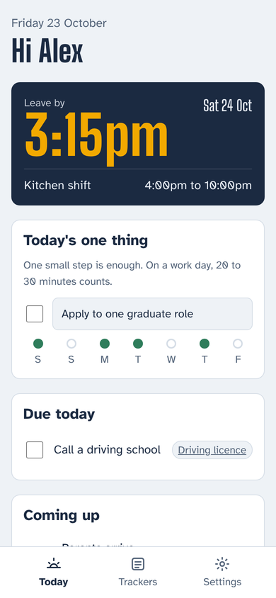
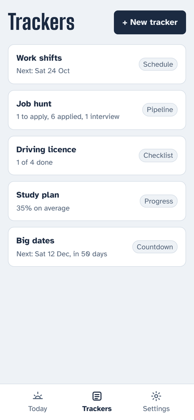
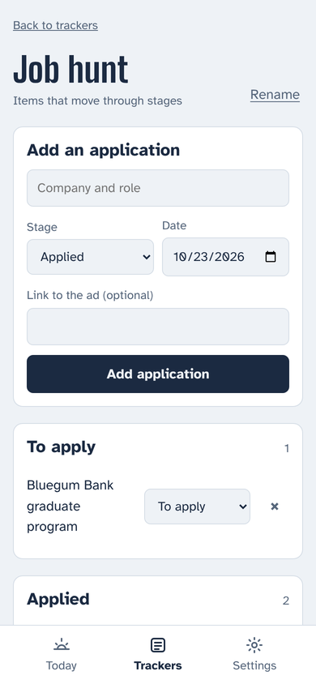
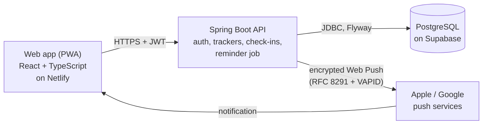

# GradPilot

A daily planner for graduates juggling a job hunt, casual shifts, study and life admin. One Today screen, trackers for anything you need to follow, and reminders on your phone, including "time to leave for work".


<p>
  
  
  
</p>

## Why

Many graduates run two lives at once: a survival job with changing shifts, and a career push of applications, study and research. Progress slips because nothing lives in one place and nothing nudges you each day. GradPilot keeps it all on one screen and asks for one small step a day.

## Features

- **Today:** a departure-board "leave by" time for your next shift, today's one thing with a seven-day streak, everything due today, countdowns to big dates, and a quick daily check-in (wake time, meals, self-care, bedtime).
- **Track anything with +:** six tracker types, each with its own screen.

  | Type | For | Example |
  | --- | --- | --- |
  | Checklist | Steps to tick off | Driving licence |
  | Pipeline | Items moving through stages | Job applications |
  | Progress | How far through something you are | Courses, books |
  | Log | Dated amounts that add up | Lesson hours |
  | Countdown | Dates to count down to | Graduation |
  | Schedule | Shifts with start and finish times | Work roster |

- **Templates:** Work shifts, Job hunt, Driving licence, Practice log, Study plan, Research project and Big date.
- **Notifications on iPhone:** a morning plan, an evening wind-down, and a "time to leave" alert before each shift, worked out from your travel time.
- **Installable:** add it to your Home Screen and it opens like a native app, with offline support for the app shell.
- **Light and dark themes**, large touch targets, legible type and reduced-motion support.

## Architecture



## Tech stack

| Layer | Choice |
| --- | --- |
| Backend | Java 21, Spring Boot 3.5, Spring Security (stateless JWT), Spring Data JPA |
| Database | PostgreSQL 16, Flyway migrations, JSONB for flexible tracker data |
| Notifications | Web Push written with the JDK only: P-256 ECDH, HKDF, AES-128-GCM and ES256 VAPID tokens |
| Frontend | React 19, TypeScript (strict), Vite, React Router, service worker |
| Testing | JUnit 5, AssertJ, Testcontainers (real PostgreSQL), MockMvc, Vitest |
| Delivery | Docker, GitHub Actions, Render, Netlify, Supabase |

## Design decisions

- **One flexible items table for every tracker type.** Common fields are real columns (date, times, stage, progress, amount) so they can be queried and indexed. Anything type-specific lives in a JSONB column, so new tracker types need no new tables.
- **Dates in the user's timezone.** "Today", shift leave times and daily notifications are worked out in each person's own timezone on the server, so a phone's clock or a trip abroad never moves a shift.
- **Web Push without a crypto library.** Message encryption (RFC 8291 / RFC 8188) and VAPID signing (RFC 8292) use the JDK's own crypto, verified against the reference JavaScript libraries and covered by round-trip tests.
- **The server only calls real push services.** Subscription addresses must belong to Apple, Google, Mozilla or Microsoft, so nobody can make the server send requests to internal addresses (SSRF).
- **Notifications that cannot double-send.** Each daily message records the day it was sent, and each reminder records when it fired. Reminders for times already passed are never sent.
- **Private by default.** Every tracker, item and check-in is scoped to its owner; asking for someone else's returns 404, so the API never confirms it exists. Log-in errors never reveal whether an email has an account.
- **Tests against a real database.** Integration tests start PostgreSQL in Docker with Testcontainers and run the real migrations. A fake push service on localhost receives real encrypted requests, and the tests decrypt them as a phone would.

## API

All endpoints except health, sign-up and log-in need an `Authorization: Bearer <token>` header. Errors are JSON [problem details](https://www.rfc-editor.org/rfc/rfc9457).

| Method | Path | Description |
| --- | --- | --- |
| GET | `/api/health` | Check the API is running |
| POST | `/api/auth/signup` | Create an account, returns a token |
| POST | `/api/auth/login` | Log in, returns a token |
| GET, PUT | `/api/me` | Your profile, timezone and reminder times |
| GET | `/api/today` | Everything the Today screen shows |
| GET | `/api/templates` | Tracker templates |
| GET, POST | `/api/trackers` | List or create trackers |
| GET, PUT, DELETE | `/api/trackers/{id}` | One tracker with its items |
| POST | `/api/trackers/{id}/items` | Add an item |
| PUT, DELETE | `/api/trackers/{id}/items/{itemId}` | Change or remove an item |
| GET | `/api/checkins?from=&to=` | Check-ins for up to 62 days |
| GET, PUT | `/api/checkins/{day}` | One day's check-in |
| GET | `/api/push/status` | Whether notifications are available, and your device count |
| POST, DELETE | `/api/push/subscriptions` | Turn notifications on or off for a device |
| POST | `/api/push/test` | Send yourself a test notification |

## Project structure

```
gradpilot/
├── backend/                 Spring Boot API
│   ├── src/main/java/com/gradpilot/
│   │   ├── auth/            Sign-up, log-in, tokens
│   │   ├── user/            Profile and settings
│   │   ├── tracker/         Trackers, items, templates
│   │   ├── checkin/         Daily check-ins
│   │   ├── today/           The Today screen
│   │   ├── push/            Web Push encryption, VAPID, subscriptions
│   │   └── notify/          Scheduled morning, evening and item reminders
│   ├── src/main/resources/db/migration/   Flyway SQL migrations
│   └── Dockerfile
├── frontend/                React web app
│   ├── src/pages/           Today, Trackers, tracker detail, Settings, Login
│   ├── src/views/           One screen per tracker type
│   └── public/sw.js         Service worker for notifications and offline use
├── docs/                    Roadmap, deployment guide, screenshots
├── render.yaml              API hosting
├── netlify.toml             Web app hosting
└── docker-compose.yml       Local PostgreSQL
```

## Run it locally

Requirements: Java 21, Maven 3.9+, Node 22 and Docker.

```bash
# 1. Start PostgreSQL
docker compose up -d

# 2. Start the API on http://localhost:8080
cd backend
mvn spring-boot:run

# 3. In another terminal, start the web app on http://localhost:5173
cd frontend
npm install
npm run dev
```

Notifications need VAPID keys. Create a pair with `npx web-push generate-vapid-keys` and set `VAPID_PUBLIC_KEY` and `VAPID_PRIVATE_KEY` before starting the API. Without them, everything else works and notifications stay off.

Run the tests:

```bash
cd backend && mvn verify      # needs Docker for Testcontainers
cd frontend && npm test
```

## Configuration

| Variable | Default | Purpose |
| --- | --- | --- |
| `DB_URL` | `jdbc:postgresql://localhost:5432/gradpilot` | Database connection |
| `DB_USERNAME` / `DB_PASSWORD` | `gradpilot` | Database login |
| `JWT_SECRET` | Development value | Token signing key, at least 32 bytes. Always set in production |
| `JWT_TTL` | `7d` | How long a login lasts |
| `VAPID_PUBLIC_KEY` / `VAPID_PRIVATE_KEY` | Not set | Notification keys; notifications are off without them |
| `VAPID_SUBJECT` | `mailto:admin@example.com` | Contact address for push services |
| `CORS_ORIGINS` | `http://localhost:5173` | Web app addresses allowed to call the API |
| `SCHEDULER_ENABLED` | `true` | Turns the reminder job on or off |
| `VITE_API_URL` (frontend) | `http://localhost:8080` | Where the web app finds the API |

## Deploy

See [docs/DEPLOY.md](docs/DEPLOY.md) for a step-by-step guide to running GradPilot on free plans at Supabase, Render and Netlify, and installing it on an iPhone.

## Roadmap

Version 1 is complete. Next up: automatic job application tracking from email, adding shifts from a roster screenshot, LeetCode and calendar connections, and a Python insights service. See [docs/ROADMAP.md](docs/ROADMAP.md).

## Author

Nithyashree KP · [GitHub](https://github.com/nithyash2) · [Portfolio](https://nithyash2.netlify.app)

## Licence

MIT
